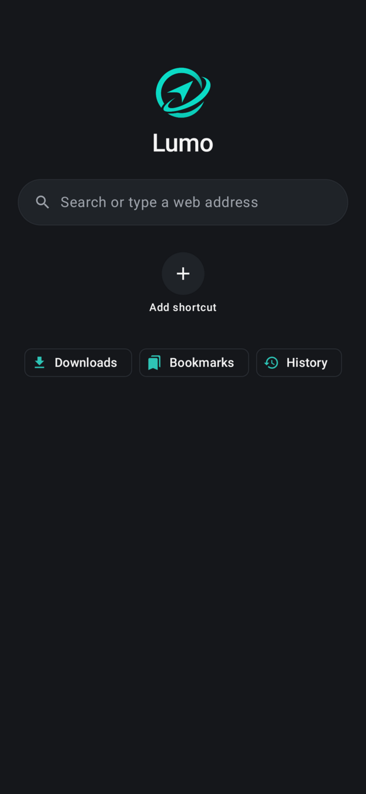
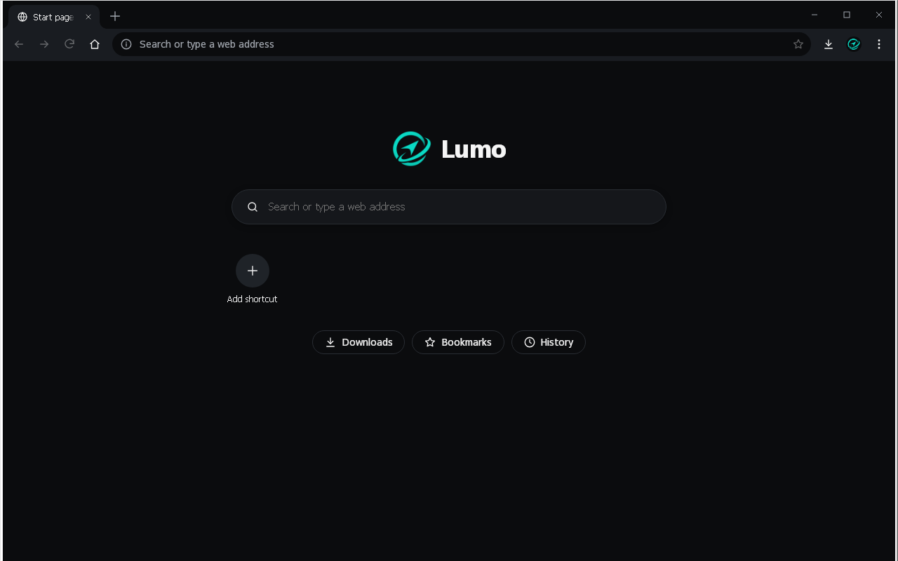

# Lumo Browser

A minimal, privacy-respecting Chromium-based browser for **Android** and **32-bit (x86) Windows**.
Dark anthracite surfaces, a restrained turquoise accent, no clutter, no telemetry.

| Android (WebView) | Windows x86 (CEF 158) |
|---|---|
|  |  |

> **Türkçe özet:** Lumo Browser; Android (Android System WebView) ve 32 bit Windows (Chromium Embedded
> Framework 158, x86) için tek bir projede geliştirilmiş, telemetrisiz, sade bir tarayıcıdır. Sekmeler, gizli
> sekmeler, indirmeler (duraklat/devam), yer imleri, geçmiş, reklam/izleyici engelleme, site izinleri, sayfada bul,
> PDF/yazdırma, ekran görüntüsü ve isteğe bağlı YZ (yalnızca Android) içerir. VPN/proxy/tünelleme **içermez** ve
> ağ yöneticisi (ör. MEB) kısıtlamalarını aşmaz. Ayrıntılar: [docs/FEATURE_MATRIX.md](docs/FEATURE_MATRIX.md).

## Downloads

Artifacts are produced by `scripts/build-windows.sh` and Gradle, and by the GitHub Actions workflow
`.github/workflows/freedom-browser.yml` (see the run's *Artifacts* section). Nothing is published under a fake link.

| Artifact | Platform | Notes |
|---|---|---|
| `LumoBrowser-1.1.0-release.apk` | Android 10+ (API 29) | R8-minified, signed with a **sideload test key** – see [docs/BUILD.md](docs/BUILD.md#release-signing) |
| `LumoBrowser-1.1.0-debug.apk` | Android 10+ | Debug build |
| `LumoBrowser-1.1.0-windows-x86-portable.zip` | Windows 10 (32-bit or 64-bit) | Unzip and run `LumoBrowser.exe`; data stays in `profile\` |
| `LumoBrowser-1.1.0-windows-x86-setup.exe` | Windows 10 (32-bit or 64-bit) | Per-user installer, no admin rights needed |

Windows 11 is 64-bit only. The x86 build runs there through WOW64, but it is intended for 32-bit Windows 10.

## Repository layout

```
freedom-browser/
├── shared/                Kotlin Multiplatform (JVM + JS): URL/search resolution, IDN, file names,
│                          block-list engine, history ranges, bookmark rules, error mapping, design tokens
├── androidApp/            Android app: Kotlin, Jetpack Compose, WebView, Room, DataStore, MVVM
├── windows/
│   ├── native-host/       C (CEF C API) Win32 host for x86: tabs, downloads, permissions, ad blocking, IPC
│   ├── ui/                Windows UI (HTML/CSS/JS inside CEF) using the shared Kotlin/JS module
│   ├── installer/         NSIS installer script (x86)
│   └── tests/e2e/         Wine end-to-end smoke test
├── scripts/               build-windows.sh, verify-shared-js.mjs, gen_android_strings.py
└── docs/                  architecture, feature matrix, x86 report, privacy, build & test results
```

## Build

```bash
# Android: unit tests + APKs
./gradlew :shared:jvmTest :androidApp:testDebugUnitTest :androidApp:assembleDebug :androidApp:assembleRelease

# Windows x86: downloads CEF 158 windows32 (SHA-1 verified), builds host + UI, verifies PE32/i386,
# creates the portable ZIP and the NSIS installer in dist/
scripts/build-windows.sh
```

Full prerequisites, signing and troubleshooting: [docs/BUILD.md](docs/BUILD.md).

## Documentation

- [1.1 UI upgrade](docs/UI_UPGRADE_1.1.md) – Chrome-style interface, what changed, what is not supported
- [Architecture](docs/ARCHITECTURE.md) – Android WebView and Windows CEF embedding, IPC security model
- [Feature matrix](docs/FEATURE_MATRIX.md) – implemented / partial / unsupported, per platform
- [Windows x86 compatibility report](docs/WINDOWS_X86_COMPATIBILITY.md) – stack decision, OS minimum, verification
- [Privacy policy](docs/PRIVACY.md)
- [Test & build results](docs/TEST_RESULTS.md)

## Network and access

Lumo uses the device's ordinary internet connection. It contains **no VPN, proxy, tunnelling, traffic
disguise or policy-bypass functionality**. A browser cannot guarantee access to every website: site-side blocks,
geographic or account restrictions, outages and network-administrator policies (school, company, MEB) still apply.

## License

MIT (see `LICENSE`). Chromium/CEF and other third-party components keep their own licenses.
